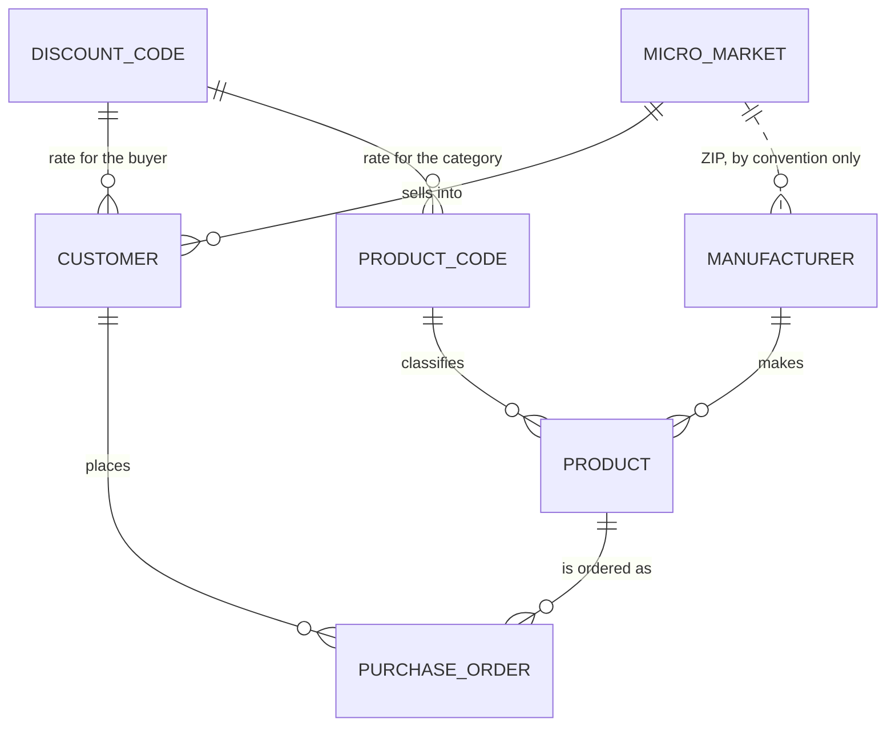

# Data dictionary

The `APP` schema has seven tables. They come from the old NetBeans sample database, and
the 109 rows in [`db/backup/`](../db/backup) are that original data, dumped one file per
table. Those rows are the only authoritative statement of what this schema is *for*, so
this document describes the tables through them.

## What this database is

A small distribution business. **Customers** live in ZIP-coded sales territories
(**micro markets**) and place **purchase orders**, each for one **product**, which a
**manufacturer** makes and a two-letter **product code** classifies. **Discount codes** are
a four-tier rate table, and they are referenced twice over: once by the customer, for who
they are, and once by the product code, for what they bought. Nothing in the application
ever computes a price from either rate — the tables carry the data, the arithmetic was
never written.



Solid lines are foreign keys the database enforces. The dotted one is not: `MANUFACTURER.ZIP`
holds ZIPs that no micro market lists, and is `CHAR(10)` where `MICRO_MARKET.ZIP_CODE` is
`VARCHAR(10)`.

## How rows get in

**Only three of the seven tables have a write path in the application** — `CUSTOMER`,
`PRODUCT` and `PURCHASE_ORDER`. The other four are read-only lookups: their DAOs implement
`getAll()` and nothing else, and the screens offer their rows as combo boxes. The
application can point at a lookup row; it can never create one. New discount codes, micro
markets, manufacturers and product codes arrive only by editing
[`db/market-schema.sql`](../db/market-schema.sql), the backup dumps, or
[`tools/gen_data.py`](../tools/gen_data.py).

Primary keys are allocated by the application, never by the database. There is no
`IDENTITY`, no sequence and no `DEFAULT` on any column. `TemplateBusiness.generateIdentifier()`
draws a random integer and retries until `findById` misses:

| Table | Range | What the backup actually holds |
|---|---|---|
| `PRODUCT` | 100000–999999, from `setIdentifierSize(6)` | 948933–988765 |
| `PURCHASE_ORDER` | 10000000–99999999, from `setIdentifierSize(8)` | 10398001–30298004 |
| `CUSTOMER` | 0–999999 — `CustomerBusiness` never calls `setIdentifierSize`, so it takes the default branch and **can generate 0** | 1, 2, 3, 25, 36 … 863 |

That check-then-insert is not transactional, and there are **no transactions anywhere** in
this codebase: every DAO call opens its own connection and every statement auto-commits on
its own. The primary key is the only real guard against a collision.

Insert parents before children: `DISCOUNT_CODE` → `MICRO_MARKET` → `MANUFACTURER` →
`PRODUCT_CODE` → `CUSTOMER` → `PRODUCT` → `PURCHASE_ORDER`. Delete in the reverse order.
Both [`db/restore.sql`](../db/restore.sql) and `tools/gen_data.py` follow exactly that
chain, and no foreign key declares `ON DELETE`, so deleting a referenced parent is refused
outright with SQL state `23503`.

---

## DISCOUNT_CODE — 4 rows

The rate table, and the root of the whole schema. One letter per tier: `H` 16.00,
`M` 11.00, `L` 7.00, `N` 0.00 — high, medium, low, none.

| Column | Type | Null | Key | Notes |
|---|---|---|---|---|
| DISCOUNT_CODE | CHAR(1) | no | PK | one letter, typed by hand into the SQL files |
| RATE | DECIMAL(4,2) | yes | | a percentage, so it caps at 99.99. Nothing applies it to a price |

**Writing a new row**

- No application path reaches this table. Add the row to a SQL file and reload.
- Add it before any `PRODUCT_CODE` or `CUSTOMER` row that references it.
- Pick a letter nothing else uses. The base seed holds `N`, `M`, `H`; the backup holds
  `H`, `M`, `L`, `N`; `db/data.sql` adds `S`, `P`, `X` precisely so it can load over
  either one. A full restore ends with seven.

```sql
INSERT INTO APP.DISCOUNT_CODE (DISCOUNT_CODE, RATE) VALUES ('K', 9.50);
```

---

## MICRO_MARKET — 11 rows

A sales territory, keyed by ZIP code, with the geometry of the area it covers. Every
customer belongs to one.

| Column | Type | Null | Key | Notes |
|---|---|---|---|---|
| ZIP_CODE | VARCHAR(10) | no | PK | five digits in all 11 rows, though the column allows ten characters |
| RADIUS | DOUBLE | yes | | 157.869 – 1987.854 in the backup |
| AREA_LENGTH | DOUBLE | yes | | |
| AREA_WIDTH | DOUBLE | yes | | |

**Writing a new row**

- No application path reaches this table either; the customer form offers these ZIPs as a
  combo box and can only choose among them.
- Add it before any `CUSTOMER` row that references it.
- The three measurements are never read by any business rule — only displayed.

```sql
INSERT INTO APP.MICRO_MARKET (ZIP_CODE, RADIUS, AREA_LENGTH, AREA_WIDTH)
VALUES ('93001', 410.250, 388.100, 275.400);
```

---

## MANUFACTURER — 30 rows

Who makes a product. A full contact record, including a named sales representative.

| Column | Type | Null | Key | Notes |
|---|---|---|---|---|
| MANUFACTURER_ID | INTEGER | no | PK | 8 digits by convention, `199xxxxx` throughout the backup |
| NAME | VARCHAR(30) | yes | | |
| ADDRESSLINE1 | VARCHAR(30) | yes | | |
| ADDRESSLINE2 | VARCHAR(30) | yes | | |
| CITY | VARCHAR(25) | yes | | |
| STATE | CHAR(2) | yes | | |
| ZIP | CHAR(10) | yes | | **fixed width, so it is blank-padded**: the dumps carry `'94043     '`. Not a foreign key, and holds ZIPs no micro market lists |
| PHONE | VARCHAR(12) | yes | | |
| FAX | VARCHAR(12) | yes | | |
| EMAIL | VARCHAR(40) | yes | | some backup values are malformed, e.g. `www.sbw@example.com` |
| REP | VARCHAR(30) | yes | | sales representative; read by no screen |

**Writing a new row**

- No application path. `model/Manufacturer.java` carries no validation constraints and the
  product form only offers existing manufacturers in a combo box.
- Add it before any `PRODUCT` that references it.
- `ZIP` is yours to choose freely. `tools/gen_data.py` draws it from the micro markets
  anyway, to keep the data sensible; the database will not hold you to it.

```sql
INSERT INTO APP.MANUFACTURER (MANUFACTURER_ID, NAME, ADDRESSLINE1, ADDRESSLINE2, CITY, STATE, ZIP, PHONE, FAX, EMAIL, REP)
VALUES (19990001, 'Northwind Devices', '12 Harbour Way', 'Unit 4', 'Portland', 'OR', '97201', '503-555-0123', '503-555-0124', 'sales@example.com', 'Dana Ruiz');
```

---

## PRODUCT_CODE — 6 rows

The product category, and the second place a discount rate attaches: `SW`→`M`, `HW`→`H`,
`FW`→`L`, `BK`→`L`, `CB`→`N`, `MS`→`N`.

| Column | Type | Null | Key | Notes |
|---|---|---|---|---|
| PROD_CODE | CHAR(2) | no | PK | exactly two letters |
| DISCOUNT_CODE | CHAR(1) | no | FK → DISCOUNT_CODE | **the application never reads or writes this column**: `ProductCodeDAO` selects `PROD_CODE, DESCRIPTION` only, and `model/ProductCode.java` has no such field |
| DESCRIPTION | VARCHAR(10) | yes | | 10 characters, so `'Peripheral'` is the longest that fits |

**Writing a new row**

- No application path. Add it to a SQL file, after the discount code it names.
- That foreign key was added on 2026-11-07; before then the column was `not null` with no
  constraint, and the base seed's `HW` row pointed at an `H` that only the backup supplied.
  It is a seed-time and script-time constraint only, since no application code touches the
  column — which is also why nothing in the UI changed when it was added.
- The constraint lands only in a database created after that date. An existing
  `~/ansel/market-db` or `target/market-db` keeps the old shape until `mvn clean` or a
  `db/restore.sql` run rebuilds it.

```sql
INSERT INTO APP.PRODUCT_CODE (PROD_CODE, DISCOUNT_CODE, DESCRIPTION) VALUES ('BT', 'N', 'Battery');
```

---

## CUSTOMER — 13 rows

Who buys. The application's validation is **stricter than the columns**: five fields the
DDL leaves nullable are `@NotEmpty` in `model/Customer.java`.

| Column | Type | Null | Key | Notes |
|---|---|---|---|---|
| CUSTOMER_ID | INTEGER | no | PK | allocated by the app from 0–999999; the backup uses small arbitrary numbers |
| DISCOUNT_CODE | CHAR(1) | no | FK → DISCOUNT_CODE | `@Valid @NotNull`; written as `String.valueOf(Character)` |
| ZIP | VARCHAR(10) | no | FK → MICRO_MARKET | `@Valid @NotNull`; the one ZIP in this schema that is enforced |
| NAME | VARCHAR(30) | yes | | `@NotEmpty @Size(max = 30)` |
| ADDRESSLINE1 | VARCHAR(30) | yes | | `@NotEmpty @Size(max = 30)` |
| ADDRESSLINE2 | VARCHAR(30) | yes | | `@Size(max = 30)` |
| CITY | VARCHAR(25) | yes | | `@NotEmpty @Size(max = 25)` |
| STATE | CHAR(2) | yes | | **fixed width**: a one-letter state is stored as `'C '` and reads back with the padding |
| PHONE | CHAR(12) | yes | | `@Pattern("\\d{3}-\\d{3}-\\d{4}")` forces exactly 12 characters, so this column never pads. Blank is stored as NULL |
| FAX | CHAR(12) | yes | | same |
| EMAIL | VARCHAR(40) | yes | | `@NotEmpty @Email @Size(max = 40)` |
| CREDIT_LIMIT | INTEGER | yes | | `@NotNull @Min(1000)` with **no upper bound**, and the field is a `Long` written with `setLong` — anything above 2147483647 passes validation and fails at the database. The backup ranges from 10,000 to 5,000,000 |

**Writing a new row**

- Through the app: *Clientes* → **Agregar**. Leave `CUSTOMER_ID` to
  `CustomerBusiness.saveOrUpdate`, which generates one when the field is null.
- The discount code and the ZIP must already exist. Both come from combo boxes, so the
  form cannot produce a dangling reference.
- Phone and fax must be exactly `999-999-9999` or empty. There is no other accepted shape.
- **The backup's own rows would not pass this form.** Customer 2's e-mail is
  `www.new.example.com`, which has no `@` at all: open that customer, press Save, and
  `@Email` rejects it. The dumps predate the validation.
- Deleting a customer that any order references is refused by the database (`23503`). The
  screen reports "No se pudo borrar el cliente" and the real reason goes only to the log.

```sql
INSERT INTO APP.CUSTOMER (CUSTOMER_ID, DISCOUNT_CODE, ZIP, NAME, ADDRESSLINE1, ADDRESSLINE2, CITY, STATE, PHONE, FAX, EMAIL, CREDIT_LIMIT)
VALUES (500123, 'N', '95117', 'Harbour Supplies', '44 Dock Street', 'Suite 2', 'Santa Clara', 'CA', '408-555-0199', '408-555-0198', 'orders@example.com', 40000);
```

---

## PRODUCT — 30 rows

What is sold. `AVAILABLE` is **derived, never entered**: `ProductBusiness.saveOrUpdate`
sets it from `quantityOnHand != 0` on every insert and update, and all 30 backup rows agree
— every `'FALSE'` row has zero stock.

| Column | Type | Null | Key | Notes |
|---|---|---|---|---|
| PRODUCT_ID | INTEGER | no | PK | allocated by the app from 100000–999999 |
| MANUFACTURER_ID | INTEGER | no | FK → MANUFACTURER | no `@NotNull` on the model field |
| PRODUCT_CODE | CHAR(2) | no | FK → PRODUCT_CODE | no constraint on the model field either |
| PURCHASE_COST | DECIMAL(12,2) | yes | | ten integer digits and two decimals. Held as a `Double` and written with `setDouble`, so it is binary floating point on the way in |
| QUANTITY_ON_HAND | INTEGER | yes | | 0 – 800000 in the backup |
| MARKUP | DECIMAL(4,2) | yes | | a percentage, so it **caps at 99.99**, and nothing checks it: `Product` carries no Bean Validation at all and its form bypasses `TechMarketValidator`. Typing 150 fails at the database. The backup stays within 1.00 – 75.00 |
| AVAILABLE | BOOLEAN | yes | | derived from `QUANTITY_ON_HAND <> 0`. The dumps write the quoted strings `'TRUE'`/`'FALSE'`, the DDL writes the literals `TRUE`/`FALSE`, and H2 accepts both. Read back with `getString` + `Boolean.parseBoolean` |
| DESCRIPTION | VARCHAR(50) | yes | | no `@Size`, so a 51-character description fails at the database |

**Writing a new row**

- Through the app: *Productos* → **Agregar**. The manufacturer and the product code come
  from combo boxes.
- Do not set `AVAILABLE` by hand unless you are writing SQL — and then keep it equal to
  `QUANTITY_ON_HAND <> 0`, or the product list will disagree with the stock. `getAll()`
  selects `WHERE QUANTITY_ON_HAND <> 0 AND AVAILABLE = TRUE`, so a mismatched row simply
  disappears from the screen.
- Keep `MARKUP` under 100 and `DESCRIPTION` under 51 characters. Nothing else will.
- Deleting a product that any order references is refused by the database (`23503`).

```sql
INSERT INTO APP.PRODUCT (PRODUCT_ID, MANUFACTURER_ID, PRODUCT_CODE, PURCHASE_COST, QUANTITY_ON_HAND, MARKUP, AVAILABLE, DESCRIPTION)
VALUES (512345, 19985678, 'HW', 249.99, 120, 18.50, TRUE, '27 inch Monitor');
```

---

## PURCHASE_ORDER — 15 rows

One customer buying one product. There is no header/detail split: the quantity, the cost
and the carrier sit on the same row as the two foreign keys, so an order is a single line.

| Column | Type | Null | Key | Notes |
|---|---|---|---|---|
| ORDER_NUM | INTEGER | no | PK | allocated by the app from 10000000–99999999 |
| CUSTOMER_ID | INTEGER | no | FK → CUSTOMER | |
| PRODUCT_ID | INTEGER | no | FK → PRODUCT | |
| QUANTITY | SMALLINT | yes | | **caps at 32767**. `@Min(1)` app-side with no upper bound; only the order form's spinner holds the ceiling |
| SHIPPING_COST | DECIMAL(12,2) | yes | | ten integer digits, but `@Digits(integer = 12, fraction = 2)` allows twelve, so two extra digits pass validation and fail at the database |
| SALES_DATE | DATE | yes | | stamped as *today* by `PurchaseOrderBusiness` on insert, never by the database |
| SHIPPING_DATE | DATE | yes | | `SALES_DATE` + 15 days unless the form supplied one. NULL means not scheduled; the model's `@FutureOrPresent` is commented out, so nothing validates it |
| FREIGHT_COMPANY | VARCHAR(30) | yes | | free text with a de-facto enum — the seven distinct backup values are exactly the order form's combo entries: Coastal Freight, FR Express, Poney Express, Slow Snail, Southern Delivery Service, We deliver, Western Fast |

**Writing a new row**

- Through the app: *Ventas* → pick a customer and a product → **Comprar**.
- The customer and the product must exist. Both come from combo boxes.
- `QUANTITY` ≥ 1, and it should not exceed the product's `QUANTITY_ON_HAND`. **Nothing
  enforces the second half** — not the database, not the application. Order 10398009 in the
  backup buys 1,000 of product 986420, which has none in stock.
- `SHIPPING_DATE` is `SALES_DATE` + 15 days unless you say otherwise. All 15 backup orders
  ship the day they were sold; do not copy that as a rule.
- An order never changes the product's stock. No code decrements `QUANTITY_ON_HAND`.

```sql
INSERT INTO APP.PURCHASE_ORDER (ORDER_NUM, CUSTOMER_ID, PRODUCT_ID, QUANTITY, SHIPPING_COST, SALES_DATE, SHIPPING_DATE, FREIGHT_COMPANY)
VALUES (10398020, 1, 980001, 10, 449.00, '2026-11-07', '2026-11-22', 'FR Express');
```

---

## What the backup does not guarantee

The dumps are historical sample data, not a model of a correct record. They predate the
application's own rules and break several of them:

- **Shipping dates.** All 15 orders ship the same day they were sold; the application
  stamps +15 days.
- **Stock.** Four orders exceed the product's `QUANTITY_ON_HAND`, including one for 1,000
  units of a product with zero.
- **E-mail.** Several customer and manufacturer values are malformed, so those customer
  rows cannot be re-saved through the form that now validates them.
- **ZIP codes.** `MANUFACTURER.ZIP` is a padded `CHAR(10)` that references nothing.
- **Prices.** `RATE` and `MARKUP` are carried but never applied; no code computes a selling
  price from a purchase cost.

`tools/gen_data.py` is the one place where "a consistent row" is written down as executable
rules, and it is worth reading before adding data by hand:

```
 *   AVAILABLE = (QUANTITY_ON_HAND <> 0)            as ProductBusiness derives it
 *   SHIPPING_DATE = SALES_DATE + 15 days           as PurchaseOrderBusiness stamps it
 *   QUANTITY <= the matching QUANTITY_ON_HAND      nothing is ordered beyond stock
 *   every order references a product in stock, and every foreign key resolves
 *   CHAR(12) phone and fax values are exactly 12 characters, so nothing is blank padded
```

## Where the data comes from

| File | What it holds |
|---|---|
| [`db/market-schema.sql`](../db/market-schema.sql) | the DDL for all seven tables, plus a 14-row seed. Replayed by `DatabaseTestContext` to build the test database |
| [`db/backup/APP_*.sql`](../db/backup) | the original sample data, 109 rows, one file per table |
| [`db/data.sql`](../db/data.sql) | 6,711 generated rows for performance work, reproducible with `python tools/gen_data.py`. Additive, and it needs a base seed to supply discount code `M`, which its `OS` product code references |
| [`db/restore.sql`](../db/restore.sql) | composes all three into one database, parents first |

Rebuild a database from scratch — destructive, and idempotent:

```bash
mvn -q compile exec:java -Dexec.mainClass=org.h2.tools.RunScript \
    -Dexec.args="-url jdbc:h2:file:./target/market-db -user app -password app -script db/restore.sql"
```

It ends at 7 discount codes, 51 micro markets, 90 manufacturers, 14 product codes,
413 customers, 1,230 products and 5,015 purchase orders.
